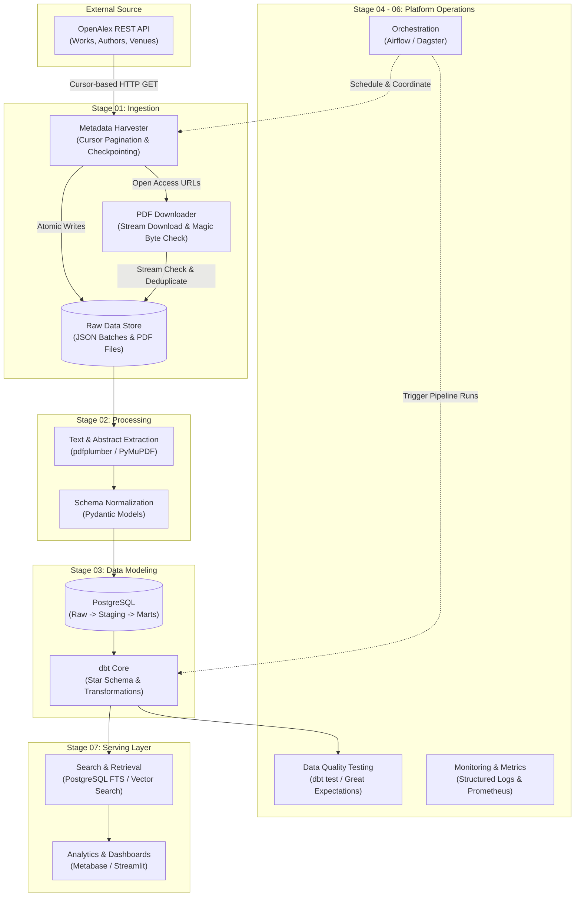

# Scholarly Pipeline

An end-to-end Data Engineering pipeline designed to harvest, validate, process, model, and serve academic research literature from the OpenAlex API.

## Project Status

**Status: In Progress (Active Development)**

Current focus: Completing Stage 01 (Ingestion & Stream Validation) and transitioning to Stage 02 (Processing & Extraction).

---

## Architecture Overview



### Interactive Architecture Diagrams

For detailed interactive diagrams with zoom, pan, theme switching, and component inspection, view the standalone HTML artifacts:

- [System Overview Architecture](docs/diagrams/system-overview.html): Complete platform blueprint across all pipeline stages.
- [Stage 01 Ingestion Architecture](docs/diagrams/01-ingestion.html): Detailed workflow of cursor pagination, atomic writes, checkpoint recovery, and idempotency.

---

## Roadmap & Implementation Progress

- [x] **Stage 01: Ingestion**
  - [x] REST client with cursor pagination and rate limit handling.
  - [x] Atomic JSON checkpoint state management for crash recovery.
  - [x] Local raw storage layer with deduplication and idempotency guarantees.
  - [x] Scheduled batch harvesting via automated jobs (cron / CLI).
  - [x] Stream-based PDF downloader with magic byte validation (`%PDF`).
  - [x] Automated unit test suite verifying idempotency and state safety.
- [ ] **Stage 02: Processing**
  - [ ] PDF text layer extraction and OCR fallback handling.
  - [ ] Abstract reconstruction from OpenAlex inverted index structures.
  - [ ] Pydantic schema validation, sanitization, and dead-letter queue routing.
- [ ] **Stage 03: Data Modeling**
  - [ ] Relational schema design (1NF to 3NF) for papers, authors, institutions, and concepts.
  - [ ] Multi-layer warehouse layout: `raw` -> `staging` -> `marts`.
  - [ ] dbt transformation models, surrogate key generation, and dimensional modeling.
- [ ] **Stage 04: Data Quality**
  - [ ] Schema enforcement, uniqueness constraints, and referential integrity tests.
  - [ ] Automated quality reports and boundary validations.
- [ ] **Stage 05: Orchestration**
  - [ ] Directed Acyclic Graph (DAG) construction with dependency resolution.
  - [ ] Incremental harvesting pipelines with automated backfill mechanisms.
- [ ] **Stage 06: Monitoring & Observability**
  - [ ] Structured logging across all pipeline components.
  - [ ] Pipeline throughput, failure rates, and latency metric dashboards.
- [ ] **Stage 07: Serving Layer**
  - [ ] Full-text search index and citation network exploration.
  - [ ] Interactive analytics dashboard for research trends.
- [ ] **Stage 08: Packaging & Deployment**
  - [ ] Multi-container deployment using Docker Compose.
  - [ ] Continuous Integration (CI) test automation via GitHub Actions.

---

## Tech Stack

| Domain | Technology | Purpose |
|---|---|---|
| Ingestion | Python 3.10+, `httpx`, `python-dotenv` | HTTP client, cursor pagination, stream validation |
| Processing | `pydantic`, `pdfplumber`, `pymupdf` | Schema enforcement, PDF parsing, text extraction |
| Storage & Warehouse | PostgreSQL 16 | Relational store, dimensional warehouse layers |
| Transformation | dbt Core (`dbt-postgres`) | Data modeling, lineage, staging and mart builds |
| Testing | `pytest`, `pytest-mock` | Unit, integration, and idempotency testing |
| Orchestration | Apache Airflow / Dagster | Workflow scheduling, task dependencies, retries |
| Observability | Python `logging`, Prometheus, Grafana | Structured event logs and performance monitoring |
| Infrastructure | Docker, Docker Compose | Reproducible local and containerized deployment |

---

## Repository Structure

```text
scholarly-pipeline/
|-- ingestion/              # Ingestion engine (harvester, PDF downloader, config)
|   |-- config.py           # Configuration loader and environment bindings
|   |-- harvester.py        # Cursor-based metadata harvesting runner
|   |-- pdf_downloader.py   # Stream download and magic byte validation
|-- storage/                # Storage layer interfaces and implementations
|   |-- storage.py          # LocalRawStore with atomic writes and deduplication
|-- tests/                  # Unit and integration test suites
|   |-- test_idempotency.py # Verification of idempotent writes and state recovery
|-- docs/                   # Documentation and architecture diagrams
|   |-- diagrams/           # Interactive standalone HTML architecture models
|       |-- system-overview.html
|       |-- 01-ingestion.html
|-- .env.example            # Template for environment variables and secrets
|-- requirements.txt        # Python dependency definitions
|-- README.md               # Project documentation and specifications
```

---

## Getting Started

### Prerequisites

- Linux or macOS environment (Windows supported via WSL2)
- Python 3.10 or higher
- Git

### 1. Clone the Repository

```bash
git clone https://github.com/quanpt090706/Scholarly-Pipeline.git
cd Scholarly-Pipeline
```

### 2. Create and Activate Virtual Environment

```bash
python3 -m venv .venv
source .venv/bin/activate
```

### 3. Install Dependencies

```bash
pip install --upgrade pip
pip install -r requirements.txt
```

### 4. Configure Environment Variables

Copy the example environment configuration and supply your details:

```bash
cp .env.example .env
```

Edit `.env` to specify your contact email (recommended by OpenAlex for polite pool access) and your API key:

```ini
OPENALEX_EMAIL="your_email@example.com"
OPENALEX_API_KEY="your_openalex_api_key"
RAW_STORAGE_PATH="raw"
STATE_FILE_PATH="raw/state.json"
```

### 5. Run the Ingestion Harvester

Execute a harvest run to fetch metadata batches from OpenAlex:

```bash
python3 -m ingestion.harvester --per-page 200 --max-records 600
```

Harvested raw data and cursor checkpoints will be written atomically to the `raw/` directory:

```text
raw/
|-- works/
|   |-- 2026-10-22/
|       |-- batch_000001.json
|       |-- batch_000002.json
|-- state.json
```

### 6. Run the Test Suite

Run pytest to ensure idempotency and storage tests pass:

```bash
PYTHONPATH=. pytest tests/ -v
```

---

## Data Attribution & Ethics

Metadata collected through this pipeline is sourced from [OpenAlex](https://openalex.org) under the [CC0 1.0 Public Domain Dedication](https://creativecommons.org/publicdomain/zero/1.0/). Open access PDFs are downloaded strictly in accordance with publisher licenses referenced within individual OpenAlex work records.
